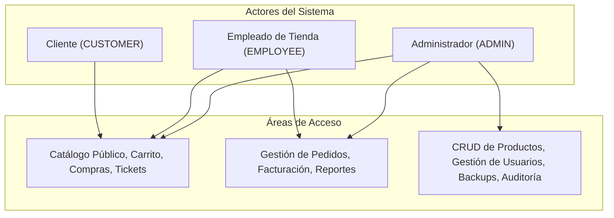
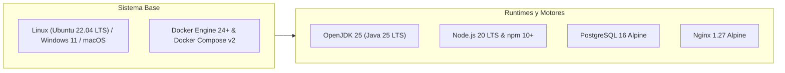
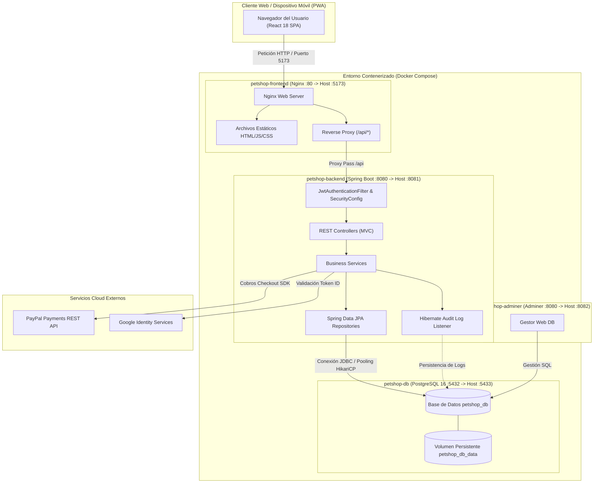
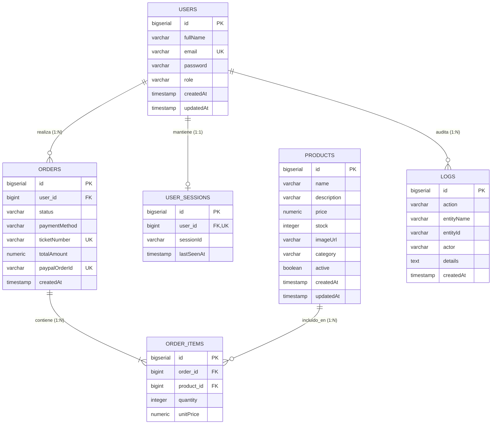
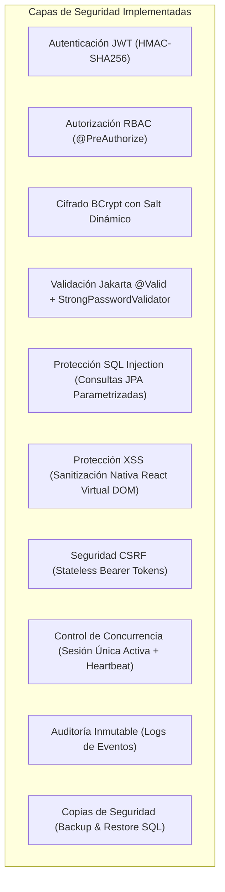
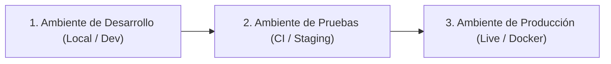

# MANUAL TÉCNICO PARA DESARROLLO DE SOFTWARE
## Sistema E-commerce Huellitas Shop

---

## 1. Portada y Control de Versiones

### Ficha Técnica del Documento
- **Nombre del Proyecto:** Huellitas Shop
- **Tipo de Sistema:** Plataforma E-commerce Full Stack & Panel Administrativo
- **Versión del Documento:** 1.0.0
- **Fecha de Emisión:** 23 de Octubre de 2026
- **Autor Principal:** Rafael Orlando Dominguez Sierra
- **Equipo Responsable:** Equipo de Ingeniería y Desarrollo Huellitas Shop
- **Estado:** Aprobado / Línea Base de Producción

### Historial de Cambios

| Versión | Fecha | Resumen del Cambio | Responsable |
| :--- | :--- | :--- | :--- |
| **0.1.0** | 17/09/2026 | Definición inicial de arquitectura REST, entidades JPA y prototipo frontend. | Equipo de Desarrollo |
| **0.5.0** | 29/09/2026 | Integración de Spring Security 6, JWT, pasarela PayPal y control de stock. | Equipo de Desarrollo |
| **0.8.0** | 04/10/2026 | Implementación de política de sesión única, heartbeat y timeout de inactividad. | Rafael Orlando Dominguez Sierra |
| **0.9.0** | 18/10/2026 | Adición de módulo de auditoría (`AuditLog`), backups SQL en caliente y reportes XLSX/PDF. | Rafael Orlando Dominguez Sierra |
| **1.0.0** | 23/10/2026 | Versión final del Manual Técnico conforme a especificaciones y CI/CD con CodeQL. | Rafael Orlando Dominguez Sierra |

### Responsable de Aprobación
- **Aprobado por:** Dirección de Arquitectura de Software & Aseguramiento de Calidad (QA)
- **Firma / Estado:** APROBADO PARA PRODUCCIÓN

---

## 2. Descripción General del Sistema

### 2.1. ¿Para qué existe este sistema? (Pregunta Guía)
**Huellitas Shop** existe para proporcionar una solución integral, confiable y segura de comercio electrónico y administración operativa para tiendas de mascotas. El sistema digitaliza la venta de alimentos, accesorios y productos de cuidado animal, facilitando a los clientes un proceso de compra ágil (con soporte web y PWA) y dotando al personal del negocio de herramientas analíticas, control estricto de inventarios, facturación mediante tickets únicos, trazabilidad de operaciones por auditoría y gestión de respaldos.

### 2.2. Objetivo del Software
Desarrollar y operar una plataforma web transaccional distribuida y desacoplada, con alta disponibilidad, control de sesiones concurrentes, pasarela de pagos internacional (PayPal) y local (efectivo), así como módulos administrativos de analítica exportable y auditoría de eventos.

### 2.3. Problema que Resuelve
1. **Desorganización en inventarios y ventas:** Evita la discrepancia de stock mediante operaciones atómicas con control transaccional JPA.
2. **Inseguridad en accesos y concurrencia:** Mitiga el secuestro de credenciales o el uso simultáneo indebido mediante sesión única por usuario e invalidación por inactividad.
3. **Falta de visibilidad financiera:** Automatiza el cálculo de métricas de ingresos, pedidos y conversión con reportes en Excel y PDF generados en tiempo real.
4. **Ausencia de trazabilidad:** Registra de forma inmutable todas las operaciones del sistema (quién, qué, cuándo y qué cambió).

### 2.4. Usuarios Objetivo



- **Cliente (`CUSTOMER`):** Usuario que explora el catálogo, administra su carrito de compras, realiza pagos vía PayPal o efectivo y consulta sus órdenes y tickets digitales.
- **Empleado (`EMPLOYEE`):** Personal de tienda facultado para consultar pedidos, validar pagos en efectivo/transferencia, actualizar estados de despacho y generar reportes consolidados.
- **Administrador (`ADMIN`):** Perfil con control maestro: gestión completa de usuarios, creación y edición de productos, ejecución y restauración de copias de seguridad de la base de datos, inspección de registros de auditoría y reportes ejecutivos.

### 2.5. Alcance Funcional
- **Catálogo Dinámico:** Filtrado en tiempo real, categorización (Perros, Gatos, Accesorios, Higiene) y búsqueda por texto.
- **Checkout Seguro:** Integración con PayPal Checkout SDK v2 y soporte para pagos presenciales en efectivo.
- **Tickets Digitales:** Emisión automática de comprobantes con identificador único de formato `HS-XXXXXX`.
- **Panel Administrativo:** Tableros de control con diseño responsivo, soporte PWA, tema claro/oscuro e internacionalización (Español / Inglés).
- **Reportes Avanzados:** Exportación de resúmenes de ventas y detalle transaccional a formato Excel (`.xlsx`) y PDF (`.pdf`).
- **Seguridad y Auditoría:** Sesión única forzada, timeout por inactividad con guardias en frontend y backend, logs inmutables en base de datos.
- **Gestión de Backups:** Generación de dumps SQL completos en tiempo de ejecución y mecanismo de restauración supervisado.

### 2.6. Restricciones Técnicas
- **Zona Horaria Oficial:** `America/Bogota` (estandarizada en JVM, Hibernate JDBC, serialización JSON Jackson y cliente web).
- **Moneda:** Pesos Colombianos (`COP`).
- **Arquitectura de Sesión:** Stateless JWT con política estricta de una sola sesión activa simultánea por cuenta de usuario.
- **Tiempo de Inactividad:** Cierre de sesión automático tras 2 minutos (configurable vía variables de entorno).

---

## 3. Requisitos Técnicos

### 3.1. Requisitos de Hardware

| Componente | Entorno de Desarrollo (Mínimo) | Servidor de Producción (Recomendado) |
| :--- | :--- | :--- |
| **Procesador (CPU)** | 4 núcleos x86_64 a 2.0 GHz (ej. Intel i5 / AMD Ryzen 5) | 4 a 8 núcleos virtuales (vCPU) a 2.5+ GHz |
| **Memoria RAM** | 8 GB de memoria física | 16 GB DDR4/DDR5 con ECC recomendado |
| **Almacenamiento** | 20 GB de espacio libre (disco SSD) | 80 GB SSD NVMe con esquema RAID / snapshots |
| **Red** | Conexión de banda ancha (mínimo 10 Mbps) | Enlace dedicado de 100 Mbps simétricos o superior |

### 3.2. Requisitos de Software



- **Sistema Operativo:** Compatible con distribuciones Linux (Ubuntu 22.04+, Debian 12, RHEL 9), Windows 11 Pro/Enterprise con WSL2, o macOS Ventura/Sonoma.
- **Motor de Base de Datos:** PostgreSQL versión 16 (distribución Alpine oficial en contenedor).
- **Servidor Web y Proxy:** Nginx 1.27 (utilizado como servidor de estáticos y Reverse Proxy hacia la API).
- **Frameworks Principales:**
  - **Backend:** Spring Boot 3.5.16 / Spring Security 6 / Spring Data JPA.
  - **Frontend:** React 18.3.1 con Vite 7.3, Tailwind CSS v4 y React Router DOM v7.
- **Dependencias y Librerías Críticas:**
  - `io.jsonwebtoken:jjwt-api:0.12.6` (autenticación y firma JWT).
  - `com.paypal.sdk:checkout-sdk:1.0.5` (pasarela de cobros PayPal).
  - `com.google.api-client:google-api-client:2.7.0` (validación de tokens OAuth2).
  - `org.apache.poi:poi-ooxml:5.3.0` (generación de hojas de cálculo Excel).
  - `com.github.librepdf:openpdf:1.3.43` (renderizado de documentos PDF).
  - `org.springdoc:springdoc-openapi-starter-webmvc-ui:2.8.13` (documentación Swagger OpenAPI).

---

## 4. Diseño Técnico y Arquitectura del Sistema

### 4.1. Estilo Arquitectónico
El sistema implementa una **Arquitectura Cliente-Servidor Desacoplada** basada en una **Single Page Application (SPA)** en el frontend y una **API RESTful Stateless** en el backend.

1. **Patrón Backend:** Arquitectura en Capas (Layered Architecture):
   - **Capa de Controladores (`Controller`):** Exposición de endpoints HTTP, validación inicial de contratos DTO y despacho de respuestas estándar.
   - **Capa de Negocio (`Service`):** Reglas de negocio transaccionales (`@Transactional`), control de flujo y orquestación de servicios externos.
   - **Capa de Acceso a Datos (`Repository`):** Abstracción de persistencia mediante Spring Data JPA e Hibernate con consultas derivadas y JPQL seguro.
   - **Capa de Modelo (`Entity`):** Mapeo objeto-relacional (ORM) hacia las tablas de PostgreSQL.
2. **Patrón Frontend:** Arquitectura basada en Componentes React, Context API (`AuthContext`, `CartContext`, `ThemeContext`, `LanguageContext`), Custom Hooks y capa de abstracción de llamadas HTTP con Axios.

### 4.2. Diagrama General de Componentes e Infraestructura



---

## 5. Módulos del Sistema

A continuación se detallan los módulos principales que componen el sistema:

### Módulo 1: Autenticación y Control de Sesión
- **Función:** Registro de clientes, inicio de sesión con email/password, autenticación Google OAuth2, cierre de sesión seguro, emisión de JWT y verificación de latidos de vida (heartbeat) para sesión única activa.
- **Entradas:** `RegisterRequest` (nombre, email, password), `AuthRequest` (email, password), `GoogleAuthRequest` (credential token).
- **Salidas:** `AuthResponse` con token JWT firmado, id de usuario, nombre completo, email y rol asignado.
- **Dependencias:** `UserRepository`, `UserSessionRepository`, `JwtService`, `ActiveSessionService`, `PasswordEncoder`.

### Módulo 2: Catálogo de Productos e Inventario
- **Función:** Consulta pública de productos con búsqueda predictiva y categorías; administración completa (CRUD) restringida a personal (`ADMIN` y `EMPLOYEE`), control de stock activo.
- **Entradas:** Criterios de búsqueda (`search`), identificadores de producto, `ProductRequest` (nombre, descripción, precio COP, stock, categoría, imagen, estado activo).
- **Salidas:** `ProductResponse`, listas de productos y códigos HTTP de confirmación.
- **Dependencias:** `ProductRepository`, `AuditLogRecorder`.

### Módulo 3: Gestión de Pedidos y Carrito (Checkout)
- **Función:** Generación de pedidos, cálculo del monto total en pesos colombianos, reserva de inventario, consulta de historial de compras por usuario y emisión de tickets con código único `HS-XXXXXX`.
- **Entradas:** `OrderRequest` (userId, lista de items con productId y cantidad, paymentMethod).
- **Salidas:** `OrderResponse` con detalle de items y estado (`PENDING`, `PAID`, `SHIPPED`, `CANCELLED`), `TicketResponse`.
- **Dependencias:** `PetOrderRepository`, `OrderItemRepository`, `ProductRepository`, `OrderSecurity`.

### Módulo 4: Pasarela de Pagos (PayPal & Efectivo)
- **Función:** Integración con la pasarela de pagos internacional PayPal Checkout SDK (creación de orden con monto convertido y captura de transacción), y confirmación manual de pagos en efectivo/transferencia por administradores.
- **Entradas:** `orderId`, `PaymentCaptureRequest` (`paypalOrderId`, `orderId`), `PaymentUpdateRequest`.
- **Salidas:** `PaymentOrderResponse` (enlace de aprobación `approveUrl`), `PaymentCaptureResponse` (estado de captura y confirmación).
- **Dependencias:** `PayPalService`, `PayPalConfig`, `PetOrderRepository`, `OrderPaidListener`.

### Módulo 5: Analítica y Reportes
- **Función:** Extracción y consolidación de métricas de ventas (ingresos totales, pedidos completados, ticket promedio, ventas por categoría y productos más vendidos) con filtrado por rangos de fecha y exportación a formatos ofimáticos.
- **Entradas:** `ReportFilter` (fechas inicio/fin, categoría, estado del pedido), `ReportFormat` (`XLSX` o `PDF`).
- **Salidas:** `ReportSummary` en JSON para tableros interactivos, o flujo binario `byte[]` con cabeceras `Content-Disposition` para descarga de archivos Excel o PDF.
- **Dependencias:** `PetOrderRepository`, `ReportAggregator`, `ExcelReportExporter` (Apache POI), `PdfReportExporter` (OpenPDF).

### Módulo 6: Auditoría y Trazabilidad Inmutable
- **Función:** Captura automática de eventos de creación, actualización y eliminación sobre entidades críticas del sistema, garantizando cumplimiento y trazabilidad técnica.
- **Entradas:** Eventos del ciclo de vida JPA/Hibernate y peticiones de autenticación.
- **Salidas:** `PageResponse<AuditLogResponse>` accesible únicamente por administradores y empleados.
- **Dependencias:** `AuditLogRepository`, `HibernateAuditListener`, `AuditActorResolver`.

### Módulo 7: Respaldo y Recuperación (Backup & Restore)
- **Función:** Generación de volcados SQL completos de la base de datos en tiempo real mediante streams de texto, consulta de metadatos de almacenamiento y ejecución de scripts de restauración.
- **Entradas:** Archivo `.sql` tipo `MultipartFile` para restauración.
- **Salidas:** Archivo SQL descargable con cabeceras HTTP de adjunto, `DatabaseInfoDto` y `RestoreResponse`.
- **Dependencias:** `BackupService`, `DataSource`, `JdbcTemplate`.

### Módulo 8: Administración de Usuarios (RBAC)
- **Función:** Mantenimiento de cuentas de usuario, asignación de roles jerárquicos (`ADMIN`, `EMPLOYEE`, `CUSTOMER`) y desactivación de accesos.
- **Entradas:** `UserCreateRequest`, `UserUpdateRequest`, identificador de usuario.
- **Salidas:** `UserResponse` con datos sanitizados (sin exponer hashes de password).
- **Dependencias:** `UserRepository`, `PasswordEncoder`, `AuditLogRecorder`.

---

## 6. Base de Datos

### 6.1. Modelo Entidad-Relación (MER)



### 6.2. Diccionario de Datos

#### Tabla: `users`
Almacena las cuentas de usuario y credenciales del sistema.

| Campo | Tipo | Longitud / Restricción | Descripción |
| :--- | :--- | :--- | :--- |
| `id` | `BIGSERIAL` | Clave Primaria (PK) | Identificador secuencial único del usuario. |
| `full_name` | `VARCHAR(255)` | `NOT NULL` | Nombre completo del usuario registrado. |
| `email` | `VARCHAR(255)` | `NOT NULL, UNIQUE` | Correo electrónico institucional o personal (login). |
| `password` | `VARCHAR(255)` | `NOT NULL` | Hash cifrado de la contraseña (BCrypt). |
| `role` | `VARCHAR(20)` | `NOT NULL` | Rol en el sistema: `ADMIN`, `EMPLOYEE`, `CUSTOMER`. |
| `created_at` | `TIMESTAMP` | `NOT NULL` | Fecha y hora de creación de la cuenta en `America/Bogota`. |
| `updated_at` | `TIMESTAMP` | `NULLABLE` | Fecha y hora de última modificación del registro. |

#### Tabla: `products`
Almacena el catálogo de productos ofrecidos en la tienda.

| Campo | Tipo | Longitud / Restricción | Descripción |
| :--- | :--- | :--- | :--- |
| `id` | `BIGSERIAL` | Clave Primaria (PK) | Identificador secuencial del producto. |
| `name` | `VARCHAR(255)` | `NOT NULL` | Nombre descriptivo del producto comercial. |
| `description` | `VARCHAR(2000)`| `NULLABLE` | Descripción detallada de especificaciones y beneficios. |
| `price` | `NUMERIC(10,2)`| `NOT NULL` | Precio de venta en Pesos Colombianos (COP). |
| `stock` | `INTEGER` | `NOT NULL` | Unidades físicas disponibles en inventario. |
| `image_url` | `VARCHAR(255)` | `NULLABLE` | URL pública de la imagen de presentación. |
| `category` | `VARCHAR(100)` | `NULLABLE` | Clasificación del producto (Perros, Gatos, etc.). |
| `active` | `BOOLEAN` | `NOT NULL, DEFAULT true` | Bandera de visibilidad en catálogo público. |
| `created_at` | `TIMESTAMP` | `NOT NULL` | Fecha y hora de alta en el sistema. |
| `updated_at` | `TIMESTAMP` | `NULLABLE` | Fecha y hora de última actualización. |

#### Tabla: `orders`
Registra los pedidos o transacciones de compra realizadas por los clientes.

| Campo | Tipo | Longitud / Restricción | Descripción |
| :--- | :--- | :--- | :--- |
| `id` | `BIGSERIAL` | Clave Primaria (PK) | Identificador único del pedido. |
| `user_id` | `BIGINT` | `FK -> users(id), NOT NULL` | Usuario que realizó el pedido. |
| `status` | `VARCHAR(30)` | `NOT NULL` | Estado: `PENDING`, `PAID`, `SHIPPED`, `CANCELLED`. |
| `payment_method` | `VARCHAR(30)` | `NULLABLE` | Medio de pago utilizado: `CASH`, `PAYPAL`. |
| `ticket_number` | `VARCHAR(20)` | `UNIQUE, NULLABLE` | Código oficial del ticket emitido (ej. `HS-000123`). |
| `total_amount` | `NUMERIC(10,2)`| `NOT NULL, DEFAULT 0` | Valor total liquidado de la orden en COP. |
| `paypal_order_id`| `VARCHAR(255)` | `UNIQUE, NULLABLE` | Identificador de transacción asignado por PayPal. |
| `created_at` | `TIMESTAMP` | `NOT NULL` | Momento exacto de radicación del pedido. |

#### Tabla: `order_items`
Detalle línea a línea de los productos y cantidades que componen una orden.

| Campo | Tipo | Longitud / Restricción | Descripción |
| :--- | :--- | :--- | :--- |
| `id` | `BIGSERIAL` | Clave Primaria (PK) | Identificador del ítem de la orden. |
| `order_id` | `BIGINT` | `FK -> orders(id), NOT NULL` | Orden a la cual pertenece este ítem. |
| `product_id` | `BIGINT` | `FK -> products(id), NOT NULL`| Producto adquirido. |
| `quantity` | `INTEGER` | `NOT NULL` | Cantidad de unidades adquiridas. |
| `unit_price` | `NUMERIC(10,2)`| `NOT NULL` | Precio unitario congelado al momento de la compra. |

#### Tabla: `user_sessions`
Garantiza y fiscaliza la sesión única activa por usuario para evitar concurrencia simultánea.

| Campo | Tipo | Longitud / Restricción | Descripción |
| :--- | :--- | :--- | :--- |
| `id` | `BIGSERIAL` | Clave Primaria (PK) | Identificador único del registro de sesión. |
| `user_id` | `BIGINT` | `FK -> users(id), UNIQUE` | Usuario propietario de la sesión activa. |
| `session_id` | `VARCHAR(36)` | `NOT NULL` | UUID único de la sesión vigente emitido en el JWT. |
| `last_seen_at` | `TIMESTAMP` | `NOT NULL` | Marca de tiempo del último latido/petición registrada. |

#### Tabla: `logs`
Registro inmutable (sin operaciones de modificación) para fines de auditoría del sistema.

| Campo | Tipo | Longitud / Restricción | Descripción |
| :--- | :--- | :--- | :--- |
| `id` | `BIGSERIAL` | Clave Primaria (PK) | Identificador secuencial del evento. |
| `action` | `VARCHAR(30)` | `NOT NULL` | Acción realizada: `CREATE`, `UPDATE`, `DELETE`, `LOGIN`, etc. |
| `entity_name` | `VARCHAR(100)` | `NOT NULL` | Nombre de la entidad impactada (`Product`, `Order`, `User`). |
| `entity_id` | `VARCHAR(100)` | `NULLABLE` | Identificador de la entidad afectada. |
| `actor` | `VARCHAR(255)` | `NOT NULL` | Email del usuario autor, `SYSTEM` o `ANONYMOUS`. |
| `details` | `TEXT` | `NULLABLE` | Resumen serializado de cambios o metadatos de la operación. |
| `created_at` | `TIMESTAMP` | `NOT NULL` | Momento exacto de ocurrencia del evento. |

---

## 7. Desarrollo y Estructura del Código

### 7.1. Organización del Código Backend (`/backend`)
El backend Java está estructurado bajo el paquete base `com.petshop`:

```text
backend/src/main/java/com/petshop/
├── audit/                  # Clases de captura automática de auditoría e interceptores Hibernate
│   ├── AuditActorResolver.java
│   ├── AuditListenerRegistrar.java
│   ├── AuditLogRecorder.java
│   └── HibernateAuditListener.java
├── config/                 # Configuraciones del framework y contexto Spring
│   ├── DataSeeder.java      # Carga de admin y catálogo inicial
│   ├── PayPalConfig.java    # Configuración de credenciales PayPal SDK
│   ├── SecurityConfig.java  # Filtros de seguridad, CORS y reglas de acceso
│   ├── SessionPolicy.java   # Políticas de sesión única (BLOCK / OVERWRITE)
│   └── SessionProperties.java
├── dto/                    # Data Transfer Objects (Contratos de API REST)
│   ├── auth/                # Payloads de login, registro y respuestas con token
│   ├── backup/              # DTOs de estado de BD y respuestas de restauración
│   ├── common/              # DTOs transversales (PageResponse)
│   ├── controller/          # Controladores REST expuestos al cliente
│   ├── log/                 # Respuestas de logs de auditoría
│   ├── order/               # Solicitudes y tickets de pedidos
│   ├── payment/             # Solicitudes y capturas de pago
│   ├── product/             # Solicitudes de creación/edición de catálogo
│   ├── report/              # DTOs de agregación y filtros de reportes
│   └── user/                # DTOs de gestión de usuarios
├── entity/                 # Entidades de persistencia JPA / Hibernate
│   ├── AuditAction.java
│   ├── AuditLog.java
│   ├── OrderItem.java
│   ├── OrderStatus.java
│   ├── PaymentMethod.java
│   ├── PetOrder.java
│   ├── Product.java
│   ├── Role.java
│   ├── User.java
│   └── UserSession.java
├── event/                  # Eventos internos de aplicación (OrderPaidEvent)
├── exception/              # Manejador global de excepciones y respuestas ApiError
│   ├── BadRequestException.java
│   ├── ForbiddenException.java
│   ├── GlobalExceptionHandler.java
│   └── ResourceNotFoundException.java
├── repository/             # Interfaces de Spring Data JPA
├── security/               # Componentes de seguridad JWT y RBAC
│   ├── CustomUserDetailsService.java
│   ├── JwtAuthenticationFilter.java
│   ├── JwtService.java
│   └── OrderSecurity.java   # Reglas SpEL de propiedad de órdenes
├── service/                # Lógica transaccional de negocio
│   ├── report/              # Lógica de cálculo, agregación y exportación de reportes
│   │   ├── export/          # Exporters para Excel (POI) y PDF (OpenPDF)
│   │   ├── OrderReportSpecifications.java
│   │   └── ReportAggregator.java
│   ├── ActiveSessionService.java
│   ├── AuditLogService.java
│   ├── AuthService.java
│   ├── BackupService.java
│   ├── OrderService.java
│   ├── PayPalService.java
│   ├── ProductService.java
│   └── UserService.java
└── validation/             # Validadores personalizados (StrongPasswordValidator)
```

### 7.2. Organización del Código Frontend (`/frontend`)
El frontend React utiliza la convención modular moderna de Vite:

```text
frontend/src/
├── components/             # Componentes visuales reutilizables
│   ├── layout/              # Navbar, Footer y contenedores estructurales
│   ├── InactivityGuard.jsx  # Guardia de inactividad de sesión
│   ├── ProductCard.jsx      # Tarjeta interactiva de producto
│   ├── ProtectedRoute.jsx   # Enrutador protegido por roles
│   ├── SessionTimeoutModal.jsx
│   └── TicketModal.jsx      # Visualizador de comprobantes de venta
├── config/                 # Constantes de configuración (inactividad, URLs)
├── context/                # Contextos globales de estado (React Context)
│   ├── AuthContext.jsx      # Estado de sesión, usuario autenticado y token
│   ├── CartContext.jsx      # Carrito de compras con persistencia local
│   ├── LanguageContext.jsx  # Soporte multilingüe (ES / EN)
│   └── ThemeContext.jsx     # Gestión de tema oscuro / claro
├── hooks/                  # Custom hooks para desacoplar comportamiento
│   ├── useIdleTimer.js      # Detección de inactividad de teclado/ratón
│   └── useSessionHeartbeat.js # Latidos HTTP hacia el backend
├── i18n/                   # Diccionarios de traducción (en.json, es.json)
├── pages/                  # Vistas de enrutamiento principal (React Router)
│   ├── AdminOrdersPage.jsx
│   ├── AdminPage.jsx        # Tablero de control de productos
│   ├── AdminReportsPage.jsx # Reportes analíticos con gráficas y descargas
│   ├── BackupPage.jsx       # Interfaz de copias de seguridad de BD
│   ├── CartPage.jsx         # Pasarela de checkout y confirmación
│   ├── HomePage.jsx         # Catálogo público interactivo
│   ├── LoginPage.jsx
│   ├── PurchasesPage.jsx    # Mis compras y visualización de tickets
│   └── RegisterPage.jsx
├── services/               # Clientes HTTP hacia la API REST (Axios)
│   ├── api.js               # Instancia de Axios con interceptor Bearer JWT
│   ├── authService.js
│   ├── orderService.js
│   ├── productService.js
│   └── reportService.js
└── utils/                  # Funciones de utilidad (moneda COP, descarga de blobs)
```

---

## 8. APIs e Integraciones

### 8.1. Matriz Resumen de Endpoints REST

| Módulo | Método | Endpoint / URI | Autenticación Requerida | Códigos HTTP | Propósito |
| :--- | :--- | :--- | :--- | :--- | :--- |
| **Auth** | `POST` | `/api/auth/register` | Público | `201`, `400` | Registro de nuevos clientes. |
| **Auth** | `POST` | `/api/auth/login` | Público | `200`, `400` | Autenticación y obtención de JWT. |
| **Auth** | `POST` | `/api/auth/logout` | Autenticado | `204`, `401` | Cierre formal de sesión activa. |
| **Auth** | `POST` | `/api/auth/heartbeat` | Autenticado | `204`, `401` | Renovación del tiempo de actividad de la sesión. |
| **Products**| `GET` | `/api/products` | Público | `200` | Consulta de catálogo público (activos). |
| **Products**| `GET` | `/api/products/{id}` | Público | `200`, `404` | Obtención de detalle por ID. |
| **Products**| `GET` | `/api/products/admin/all` | `ADMIN`, `EMPLOYEE` | `200`, `403` | Listado completo de inventario. |
| **Products**| `POST` | `/api/products` | `ADMIN`, `EMPLOYEE` | `201`, `400`, `403` | Creación de nuevo producto. |
| **Products**| `PUT` | `/api/products/{id}` | `ADMIN`, `EMPLOYEE` | `200`, `400`, `404` | Actualización de precio, stock o datos. |
| **Products**| `DELETE`| `/api/products/{id}` | `ADMIN` | `204`, `404` | Eliminación definitiva de producto. |
| **Orders** | `GET` | `/api/orders` | `ADMIN`, `EMPLOYEE` | `200`, `403` | Consulta paginada de todos los pedidos. |
| **Orders** | `GET` | `/api/orders/user/{userId}` | `ADMIN` o Propietario | `200`, `403` | Historial de compras de un cliente. |
| **Orders** | `GET` | `/api/orders/{id}` | `ADMIN` o Propietario | `200`, `404` | Detalle específico de un pedido. |
| **Orders** | `GET` | `/api/orders/{id}/ticket` | `ADMIN` o Propietario | `200`, `404` | Consulta de comprobante de venta digital. |
| **Orders** | `POST` | `/api/orders` | `ADMIN` o Propietario | `201`, `400` | Creación y radicación de orden. |
| **Orders** | `PATCH`| `/api/orders/{id}/status` | `ADMIN`, `EMPLOYEE` | `200`, `400` | Modificación de estado (ej. `SHIPPED`). |
| **Orders** | `PATCH`| `/api/orders/{id}/payment` | `ADMIN`, `EMPLOYEE` | `200`, `400` | Confirmación de pago en efectivo. |
| **PayPal** | `POST` | `/api/payment/paypal/create-order` | `ADMIN` o Propietario | `200`, `400` | Creación de orden en PayPal Checkout. |
| **PayPal** | `POST` | `/api/payment/paypal/capture` | `ADMIN` o Propietario | `200`, `400` | Captura de fondos autorizados en PayPal. |
| **Reports**| `GET` | `/api/reports/summary` | `ADMIN`, `EMPLOYEE` | `200`, `403` | Resumen analítico de ventas en JSON. |
| **Reports**| `GET` | `/api/reports/export` | `ADMIN`, `EMPLOYEE` | `200`, `403` | Descarga de reporte en `.xlsx` o `.pdf`. |
| **Users** | `GET` | `/api/users` | `ADMIN`, `EMPLOYEE` | `200`, `403` | Listado general de usuarios registrados. |
| **Users** | `POST` | `/api/users` | `ADMIN` | `201`, `400` | Creación administrativa de usuario. |
| **Users** | `PUT` | `/api/users/{id}` | `ADMIN` | `200`, `400` | Edición de rol o datos de usuario. |
| **Users** | `DELETE`| `/api/users/{id}` | `ADMIN` | `204`, `404` | Eliminación de usuario del sistema. |
| **Logs** | `GET` | `/api/logs` | `ADMIN`, `EMPLOYEE` | `200`, `403` | Registro paginado de auditoría inmutable. |
| **Backup** | `GET` | `/api/backup/info` | Autenticado | `200`, `401` | Estadísticas y tamaño de la base de datos. |
| **Backup** | `GET` | `/api/backup/download` | Autenticado | `200`, `401` | Descarga de volcado SQL completo. |
| **Backup** | `POST` | `/api/backup/restore` | Autenticado | `200`, `500` | Restauración de base de datos desde `.sql`. |

### 8.2. Ejemplos de Peticiones y Respuestas

#### A. Inicio de Sesión (`POST /api/auth/login`)
**Petición:**
```json
{
  "email": "cliente@correo.com",
  "password": "Password123!"
}
```

**Respuesta Exitosa (`200 OK`):**
```json
{
  "token": "eyJhbGciOiJIUzI1NiIsInR5cCI6IkpXVCJ9...",
  "id": 14,
  "fullName": "Carlos Pérez",
  "email": "cliente@correo.com",
  "role": "CUSTOMER"
}
```

#### B. Creación de Pedido (`POST /api/orders`)
**Petición:**
```json
{
  "userId": 14,
  "paymentMethod": "PAYPAL",
  "items": [
    {
      "productId": 1,
      "quantity": 2
    }
  ]
}
```

**Respuesta Exitosa (`201 CREATED`):**
```json
{
  "id": 105,
  "userId": 14,
  "status": "PENDING",
  "paymentMethod": "PAYPAL",
  "ticketNumber": "HS-000105",
  "totalAmount": 79800.00,
  "createdAt": "2026-10-23T08:30:00",
  "items": [
    {
      "id": 210,
      "productId": 1,
      "productName": "Alimento Premium para Perro",
      "quantity": 2,
      "unitPrice": 39900.00,
      "subtotal": 79800.00
    }
  ]
}
```

### 8.3. Integraciones con Servicios Externos
- **PayPal Checkout SDK (v2):** Permite pagos internacionales seguros. El backend crea la orden con montos parametrizados y devuelve enlaces de aprobación (`approveUrl`). Una vez el usuario aprueba la transacción en la pasarela de PayPal, el endpoint de captura confirma la recepción de los fondos y marca el pedido como `PAID`.
- **Google OAuth 2.0:** Integración con Google Identity Services para autenticación federada, verificando la validez del token JWT en los servidores de Google mediante `GoogleIdTokenVerifier`.
- **Apache POI (OOXML):** Motor generador de libros binarios de Microsoft Excel (`.xlsx`) estructurados con estilos, formatos numéricos monetarios y totales calculados.
- **LibrePDF / OpenPDF:** Motor de renderizado vectorial para generar reportes ejecutivos en formato PDF con tablas alineadas y membretes institucionales.

---

## 9. Seguridad



### 9.1. Autenticación y Autorización por Roles (RBAC)
- **Token JWT:** Firma criptográfica HMAC-SHA con expiración parametrizable (`JWT_EXPIRATION_MS`, por defecto 24 horas). Cada token incluye en sus claims el identificador único de sesión (`sessionId`).
- **Control de Acceso Basado en Roles:** Anotaciones `@PreAuthorize("hasRole('ADMIN')")`, `@PreAuthorize("hasAnyRole('ADMIN', 'EMPLOYEE')")` y comprobaciones granulares a nivel de método como `@orderSecurity.ownsOrder(#id, authentication)` para asegurar que un cliente solo pueda ver sus propios comprobantes y compras.

### 9.2. Cifrado y Almacenamiento Seguro
- **Contraseñas:** Hasheadas mediante el algoritmo `BCryptPasswordEncoder` (con factor de costo balanceado y salt aleatorio por credencial). En ningún punto del ciclo de vida se almacenan ni registran contraseñas en texto claro.

### 9.3. Validación de Entradas
- Uso de anotaciones estándar Jakarta Bean Validation: `@NotNull`, `@Positive`, `@Size`, `@Email`.
- Validador personalizado `StrongPasswordValidator` que impone:
  - Longitud mínima de 8 caracteres.
  - Al menos una letra mayúscula y una letra minúscula.
  - Al menos un dígito numérico.
  - Al menos un carácter especial (ej. `!@#$%^&*`).

### 9.4. Mitigación de Vulnerabilidades Comunes (OWASP Top 10)
- **Inyección SQL (SQLi):** Mitigada al 100% mediante el uso exclusivo de Spring Data JPA, Hibernate ORM y consultas parametrizadas con `JdbcTemplate`.
- **Cross-Site Scripting (XSS):** React escapa de forma predeterminada cualquier variable insertada en el Virtual DOM, neutralizando la inyección de etiquetas `<script>` o manipulaciones maliciosas del DOM.
- **Cross-Site Request Forgery (CSRF):** Al ser una arquitectura de API REST Stateless consumida mediante la cabecera HTTP `Authorization: Bearer <token>` y sin depender de cookies de sesión automáticas en el navegador, la vulnerabilidad CSRF queda mitigada de origen.
- **Control de Sesiones Concurrentes:** El servicio `ActiveSessionService` intercepta cada petición. Si un usuario abre sesión en un dispositivo alternativo, la sesión anterior es revocada con el código de error `SESSION_REPLACED`. Además, si el usuario permanece inactivo más de 2 minutos sin emitir pings de `heartbeat`, la sesión se invalida por inactividad.

### 9.5. Auditoría y Trazabilidad de Operaciones
- Las entidades principales (`Product`, `PetOrder`, `User`) están enlazadas a un listener de Hibernate (`HibernateAuditListener`) que intercepta eventos de inserción, actualización y borrado. Cada evento genera un registro inmutable en la tabla `logs` capturando la fecha, el autor (email o `SYSTEM`), la entidad afectada y el detalle de los atributos modificados.

### 9.6. Respaldos y Restauración de Base de Datos
- El sistema cuenta con endpoints administrativos para extraer copias de seguridad de la base de datos en caliente mediante volcados SQL exportables con marca de tiempo, así como mecanismos de restauración transaccional protegidos.

---

## 10. Implementación: Instalación y Configuración

### 10.1. Paso a Paso para Despliegue en Entorno Local

#### Paso 1: Clonar el Repositorio de Código
```bash
git clone https://github.com/usuario/api2.git
cd api2
```

#### Paso 2: Configurar las Variables de Entorno (`.env`)
Crear un archivo `.env` en la raíz del proyecto basado en la siguiente plantilla:

```ini
# Configuración de Base de Datos PostgreSQL
POSTGRES_DB=petshop_db
POSTGRES_USER=postgres
POSTGRES_PASSWORD=TuPasswordSeguro123!
POSTGRES_PORT=5433

# Puertos del Host
BACKEND_PORT=8081
FRONTEND_PORT=5173

# Seguridad y JWT
JWT_SECRET=dGVzdF9zZWNyZXRfa2V5X3Rlc3Rfc2VjcmV0X2tleV90ZXN0X3NlY3JldF9rZXk=
JWT_EXPIRATION_MS=86400000

# Credenciales de Inicialización
ADMIN_INITIAL_PASSWORD=Admin12345!

# Pasarela PayPal
PAYPAL_CLIENT_ID=sb-dummy-client-id
PAYPAL_CLIENT_SECRET=sb-dummy-client-secret
PAYPAL_MODE=sandbox

# Google OAuth 2.0
GOOGLE_CLIENT_ID=dummy-google-client-id.apps.googleusercontent.com

# URLs y CORS
FRONTEND_URL=http://localhost:5173
CORS_ALLOWED_ORIGINS=http://localhost:5173

# Políticas de Aplicación
JPA_DDL_AUTO=update
SWAGGER_ENABLED=true
SESSION_POLICY=BLOCK
SESSION_INACTIVITY_TIMEOUT=2m
VITE_INACTIVITY_TIMEOUT_MS=300000
VITE_INACTIVITY_WARNING_MS=150000
```

#### Paso 3: Despliegue Automatizado con Docker Compose
Para compilar y levantar todos los servicios en contenedores aislados:

```bash
docker compose up --build -d
```

#### Paso 4: Verificación de Contenedores y Salud de Servicios
Ejecutar el comando de verificación:

```bash
docker compose ps
```

**Resultado esperado:**
- `petshop-db`: Estado `Up (healthy)` en el puerto local `5433->5432`.
- `petshop-backend`: Estado `Up` en el puerto local `8081->8080`.
- `petshop-frontend`: Estado `Up` en el puerto local `5173->80`.
- `petshop-adminer`: Estado `Up` en el puerto local `8082->8080`.

#### Paso 5: URLs de Acceso a los Servicios
- **Aplicación Web (Frontend):** `http://localhost:5173`
- **API REST Backend:** `http://localhost:8081/api`
- **Documentación Swagger OpenAPI:** `http://localhost:8081/swagger-ui.html`
- **Gestor Web de Base de Datos (Adminer):** `http://localhost:8082`

---

### 10.2. Ejecución Independiente sin Docker (Modo Desarrollo)

Si se desea depurar el código fuente de forma interactiva en la estación de trabajo:

#### Requisitos Previos:
- Java JDK 25 instalado y configurado en el `JAVA_HOME`.
- Node.js versión 20 LTS o superior.
- Base de datos PostgreSQL activa en el puerto 5432 (o 5433).

#### Backend (Spring Boot):
```bash
cd backend
mvn clean spring-boot:run
```

#### Frontend (React + Vite):
```bash
cd frontend
npm install
npm run dev
```

#### Ejecución de Pruebas Automatizadas:
```bash
# Backend (Pruebas unitarias y de integración)
cd backend
mvn test
mvn verify

# Frontend (Compilación y auditoría de vulnerabilidades)
cd frontend
npm run build
npm audit --audit-level=high
```

---

## 11. Despliegue

### 11.1. Ambientes de la Plataforma



1. **Ambiente de Desarrollo:**
   - Base de datos local o en contenedor ligero.
   - Hot-reloading en el frontend con Vite.
   - Swagger OpenAPI habilitado para pruebas manuales de endpoints.
2. **Ambiente de Pruebas / Integración Continua (CI):**
   - Ejecutado automáticamente en GitHub Actions para cada `push` o `pull_request`.
   - Contenedor de PostgreSQL efímero inicializado para ejecutar la suite completa de pruebas Maven (`mvn -B verify`).
   - Verificación de empaquetado de frontend con `npm run build` y escaneo de vulnerabilidades `npm audit`.
3. **Ambiente de Producción:**
   - Contenedores Docker multi-stage optimizados (construcción limpia y artefactos mínimos).
   - Nginx configurado con compresión gzip, caché de estáticos y proxy inverso seguro.
   - Swagger deshabilitado (`SWAGGER_ENABLED=false`).
   - Volúmenes de base de datos persistentes con snapshots diarios.

### 11.2. Tecnologías de Despliegue e Infraestructura
- **Docker Compose:** Orquesta las 4 piezas del sistema (`db`, `backend`, `frontend`, `adminer`) gestionando redes internas privadas (`default network`) y variables inyectadas.
- **Nginx (Reverse Proxy):** Evita problemas de CORS en producción al recibir todas las peticiones en el puerto `80/443` y redirigir internamente las rutas `/api/*` al contenedor del backend `petshop-backend:8080`.

### 11.3. Pipeline de Integración Continua (CI/CD)
El proyecto implementa un flujo de trabajo formal en `.github/workflows/ci.yml`:
- **Job de Backend:** Configura JDK 25, inicializa PostgreSQL 16 Alpine con healthchecks, ejecuta `mvn -B verify` y publica los reportes Surefire como artefactos de compilación.
- **Job de Frontend:** Configura Node 20, ejecuta `npm ci`, compila con `npm run build` y audita dependencias con `npm audit --audit-level=high`.
- **Job de Seguridad (CodeQL):** Análisis estático automatizado de vulnerabilidades de código fuente (SAST) para Java y JavaScript/TypeScript.

---

## 12. Mantenimiento del Sistema

El plan de mantenimiento garantiza la continuidad operacional, seguridad y rendimiento de la plataforma:

### 12.1. Actualizaciones y Parches de Seguridad
- **Dependencias Backend:** Ejecutar periódicamente `mvn versions:display-dependency-updates` para verificar nuevas versiones de Spring Boot y librerías auxiliares.
- **Dependencias Frontend:** Ejecutar `npm outdated` y resolver vulnerabilidades reportadas con `npm audit fix`.

### 12.2. Monitoreo de Salud Operativa
- Monitoreo del estado de salud de los contenedores mediante `docker compose ps` y el comando nativo `pg_isready -U postgres -d petshop_db`.
- Inspección de registros de ejecución en tiempo real mediante:
  ```bash
  docker compose logs -f backend
  docker compose logs -f db
  ```

### 12.3. Estrategia de Copias de Seguridad (Backups)
- **Frecuencia Recomendada:** Respaldo diario automático programado en horario de bajo tráfico (02:00 AM hora de Colombia).
- **Herramienta Nativa:** `pg_dump` para generar volcados consistentes en caliente:
  ```bash
  docker exec -t petshop-db pg_dump -U postgres -d petshop_db -F c -b -v -f /var/lib/postgresql/data/backup_$(date +%Y%m%d).dump
  ```
- **Descarga Vía API:** Posibilidad de que el usuario administrador descargue el script SQL directamente desde el módulo `/api/backup/download`.

### 12.4. Recuperación ante Fallos (Disaster Recovery)
- En caso de corrupción o pérdida de datos:
  1. Detener el contenedor del backend para evitar escrituras concurrentes: `docker compose stop backend`.
  2. Restaurar el volcado SQL más reciente utilizando `pg_restore` o el endpoint `/api/backup/restore`.
  3. Validar la integridad referencial y reiniciar el backend: `docker compose start backend`.

### 12.5. Escalabilidad del Sistema
- **Escalabilidad Horizontal del Backend:** Dado que la API es estrictamente Stateless (el token JWT contiene la sesión y los estados se validan contra la base de datos), se pueden desplegar múltiples réplicas del contenedor `petshop-backend` balanceadas mediante Nginx o un Load Balancer Cloud (AWS ALB / GCP Cloud Load Balancing).
- **Escalabilidad de Base de Datos:** Configuración de réplicas de solo lectura (Read Replicas) para consultas masivas de catálogo y reportes analíticos pesados.

---

## 13. Recomendaciones de Buenas Prácticas

1. **Documentar Continuamente:** Cualquier nuevo endpoint, cambio en las entidades de la base de datos o nueva regla de negocio debe reflejarse inmediatamente en este manual técnico y en las anotaciones de Swagger OpenAPI.
2. **Mantener Versionado Semántico:** Seguir rigurosamente la convención `MAJOR.MINOR.PATCH` para etiquetar versiones estables del sistema en los tags de Git.
3. **Uso de Diagramas Actualizados:** Mantener los diagramas de componentes y de entidad-relación sincronizados con los scripts de base de datos y la topología de red.
4. **Respetar la Zona Horaria:** Toda fecha procesada debe respetar inequívocamente la zona horaria oficial `America/Bogota` para evitar desajustes en el cierre de ventas y la emisión de tickets.
5. **No Almacenar Secretos en el Repositorio:** Asegurar que el archivo `.env` se mantenga permanentemente listado en el `.gitignore`. Las credenciales de producción deben ser inyectadas a través del gestor de secretos del proveedor de infraestructura o del repositorio CI/CD.
6. **Lenguaje Técnico Claro:** Estandarizar la nomenclatura de clases, commits y documentación técnica en todo el ciclo de vida del desarrollo.

---
*Fin del Manual Técnico - Huellitas Shop v1.0.0*
